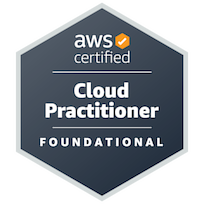

<div align="center">

<a href="https://nileshbera.in">

</a>

### Developer | Building Ideas into Products


<br/>

<a href="https://nileshbera.in">

</a>
<a href="https://github.com/nilesh384">

</a>
<a href="https://www.linkedin.com/in/nilesh-bera-2775ab313/">

</a>

<br/><br/>


</div>

---

## About Me

I'm Nilesh Bera, a developer passionate about building applications and turning innovative ideas into practical solutions.

I enjoy exploring new technologies, developing full-stack products, and experimenting with AI-powered solutions. I am particularly interested in software architecture, problem-solving, and building technology that creates real-world impact.

- 🚀 Developing full-stack applications.
- 🤖 Exploring Artificial Intelligence and automation.
- 🧠 Learning system design and scalable architecture.
- 🏆 Participating in hackathons and technical events.
- 🌐 Exploring open-source development.

<details>
<summary><b>Developer Profile</b></summary>

```javascript
const nilesh = {
    role: "Developer",
    interests: [
        "Full Stack Development",
        "Artificial Intelligence",
        "System Design",
        "Open Source",
        "Startup Innovation"
    ],
    currentlyLearning: [
        "Scalable Architecture",
        "AI Integration",
        "Advanced DSA"
    ],
    philosophy: "Build. Break. Learn. Repeat."
};
```

</details>

---

## Technical Skills

<div align="center">

**Programming Languages**


<br/><br/>

**Frontend & Mobile Development**


<br/><br/>

**Backend & Databases**


<br/><br/>

**Tools & Platforms**


</div>

---

## Featured Projects

<div align="center">

<a href="https://github.com/nilesh384/JanSetu">

</a>

</div>

| Project | Description |
|:---|:---|
| 🏛️ **JanSetu** | Mobile application for reporting local issues and public grievances. |
| 🌍 **Service Platform** | On-demand service booking platform inspired by Urban Company. |
| 📅 **Exam Scheduler** | Automatically converts examination schedules into Google Calendar events. |
| ✈️ **Flight Management** | Flight management system developed as a software engineering project. |

<details>
<summary><b>Explore More Projects</b></summary>

Explore my [GitHub repositories](https://github.com/nilesh384?tab=repositories) for more projects, experiments, and development work.

</details>

---

## Certifications

<div align="center">

<a href="https://www.credly.com/badges/4befed21-6b2a-4789-9ad8-f6fe20eecce4/public_url">

</a>

### AWS Certified Cloud Practitioner


[View Verified Credential ↗](https://www.credly.com/badges/4befed21-6b2a-4789-9ad8-f6fe20eecce4/public_url)

</div>

---

## GitHub Overview

<div align="center">


<br/><br/>


<br/><br/>


</div>

<details>
<summary><b>GitHub Achievements</b></summary>

<br/>

<div align="center">


</div>

</details>

---

## Current Focus

<div align="center">

| Area | Focus |
|:---|:---|
| Full Stack Development | Building scalable applications |
| Artificial Intelligence | Exploring AI-powered solutions |
| System Design | Learning distributed systems and architecture |
| Hackathons | Developing innovative solutions |
| Open Source | Collaborating and contributing |

</div>

---

## Let's Connect

<div align="center">

I'm always interested in connecting with developers, collaborating on interesting projects, and exploring new opportunities.

<br/>

<a href="https://www.linkedin.com/in/nilesh-bera-2775ab313/">

</a>

<a href="mailto:nileshbera258@gmail.com">

</a>

<a href="https://nileshbera.in">

</a>

<br/><br/>

### "Building today what tomorrow will need."

<br/>

<a href="https://nileshbera.in">

</a>

</div>